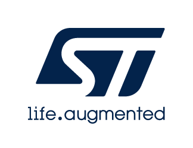

# Release Notes for
# <mark>STM32H7Pxx HAL Drivers SW Pack</mark>

# Purpose

STM32Cube enables developers to achieve design success. With a comprehensive suite of professional development tools and embedded software components, STM32Cube allows developers to differentiate products, streamline design cycles, and reduce costs. STM32Cube ecosystem supports all design steps, including selection, configuration, development, debugging, programming, and monitoring.

The STM32Cube embedded software offer provides ready-to-use software components that can be added to a project. It includes STM32 peripheral driver APIs with two levels of abstraction, middleware, board drivers, and examples. There are several distribution channels, including the STM32CubeMX2 tool, the ST website, and GitHub. All embedded software comes with enhanced online documentation, with flowcharts and user sequences.

More detailed documentation is available at [STM32H7Pxx HAL Drivers online documentation](https://dev.st.com/stm32cube-docs/stm32h7pxx-hal-drivers/latest/en/index.html)

# Update History

<label for="collapse-section-2.0.0" aria-hidden="true">__2.0.0 / 25-September-2026__</label>

## Main Changes

### First official release of **STM32H7Pxx HAL Drivers**

## Contents

- **HAL/LL Drivers** are available for all peripherals:
  - **System** : AXIM, CORTEX, CRS, DBGMCU, DMA, IWDG, PWR, Q, RCC, RTC, SBS, WWDG
  - **I/O** : EXTI, GPIO
  - **Analog** : ADC, COMP, DAC, DTS, VREFBUF
  - **Timers** : HRTIM, LPTIM, TIM
  - **Connectivity** : FDCAN, I2C, I2S, I3C, LPUART, SDMMC (SD, SDIO, MMC), SMBUS, SPI,  UART, UCPD, USART, USB
  - **Computing** : CORDIC, CRC, FMAC, HSP
  - **Memory** : FLASH, FMC (NAND, NOR, SRAM, SDRAM), RAMECC, XSPI (DLYB)
  - **Security** : HASH, RNG, TAMP
  - **Multimedia** : ADF
- **Utils** are available for FDCAN, I2C, I3C peripherals.

## Development toolchains and compilers

- IAR Embedded Workbench for ARM (EWARM) toolchain V9.60.3 + ST-LINK
- MDK-ARM Keil uVision V5.42
- STM32CubeIDE for Visual Studio Code (GCC13 compiler)
- STM32CubeMX2 V1.1.1

## Supported devices and boards

- STM32H7P4xx, STM32H7P5xx devices
- NUCLEO-H7P5II, STM32H7P5-DK

## Known Limitations

- **HAL I2S** :
    - ARMCC v6.24.0 compilation with -Oz optimization may reorder peripheral memory accesses causing initialization and execution issues in HAL I2S driver.

- **HAL I3C** :
    - Acknowledgement issue is observed after 2 consecutive aborts (interrupt race condition).

- **HAL FMC-NOR**
  - The FMC NOR driver was functionally tested on STM32 hardware to achieve the highest possible code coverage with commercially available memories. However, due to issues in memory availability, the driver is not tested with NOR CFI1 and NOR CFI3 memories.

## Backwards compatibility

- None

## Dependencies

- STM32H7Pxx DFP 2.0.0

For complete documentation on STM32 Microcontrollers,
visit: [www.st.com/stm32](https://www.st.com/en/microcontrollers-microprocessors/stm32-32-bit-arm-cortex-mcus.html)
<abbr title="Based on template cx566953 version 2.1"></abbr>